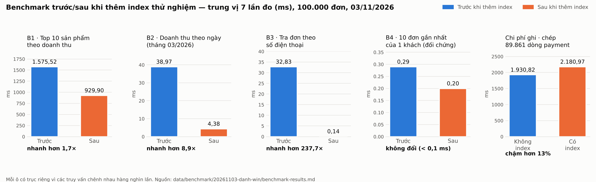

# Benchmark trên đúng bộ dữ liệu của Q01–Q25 — 03/11/2026

Người chạy: **Phạm Thành Danh**. Mục đích: đo benchmark trên **cùng bộ dữ liệu 100.000 đơn** đã dùng cho
`report/appendix/queries/20261025/`, để chương 10 dùng một bộ dữ liệu duy nhất cho cả truy vấn lẫn benchmark.

## Cách chạy

1. Database sạch, không nạp seed nhỏ: `DROP DATABASE` → `01_schema` → `02_constraints` → `04_functions` → `05_triggers`.
2. `python data\generator\generate_data.py --customers 10000 --sellers 100 --products 1000 --orders 100000 --seed 20261003`
   — 678,3 giây (ảnh: `generator-100k-terminal.png`).
3. `python data\benchmark\run_benchmark.py --label 20261103-danh-win` — 44 giây (ảnh: `benchmark-terminal.png`).
   Script tự ghi `metadata.md`, `benchmark-results.md`, `explain-baseline.txt`, `explain-optimized.txt`.
4. Sau benchmark, ghi tổng quan và dấu vân tay dữ liệu: `SOURCE report/appendix/queries/20261025/tong_quan_du_lieu.sql`
   → `00_tong_quan_du_lieu.txt` (MySQL client `--default-character-set=utf8mb4`).

Môi trường: Windows 11, MySQL 8.4.11 (REPEATABLE-READ, buffer pool 128 MB), Python 3.15.0, Faker 40.43.0, PyMySQL 2.2.8.

## Xác nhận cùng bộ dữ liệu với Q01–Q25

| Chỉ số | 25/10 (Q01–Q25) | 03/11 (benchmark này) |
|---|---|---|
| orders / order_item / payment | 100.000 / 200.294 / 89.861 | 100.000 / 200.294 / 89.861 ✅ |
| tong_tien | 1299341550400.00 | 1299341550400.00 ✅ |
| van_tay_don | 214963667966105 | 214963667966105 ✅ |
| van_tay_dong_hang | 430637245459748 | 430637245459748 ✅ |
| van_tay_khach | 21487872654796 | 21487872654796 ✅ |

Đây là lần thứ ba generator (cùng seed) sinh ra đúng bộ dữ liệu này (hai lần ngày 25/10 và lần này).
Các kiểm tra tính đúng trong `00_tong_quan_du_lieu.txt` đều bằng 0.

## Kết quả (`benchmark-results.md`, trung vị 7 lần đo sau 3 lần làm nóng)

| Mã | Truy vấn | Trước | Sau | Nhanh hơn | Kế hoạch thực thi thay đổi |
|---|---|---|---|---|---|
| B1 | Top 10 sản phẩm theo doanh thu | 1.575,52 ms | 929,90 ms | 1,7× | Đổi thứ tự nối: trước bắt đầu từ `orders` (quét covering index 100.000 đơn), sau bắt đầu từ `product` và tra `order_item` bằng **covering index** mới |
| B2 | Doanh thu theo ngày, tháng 03/2026 | 38,97 ms | 4,38 ms | 8,9× | **Table scan 89.861 dòng `payment` → covering index range scan** chỉ trong tháng 3 |
| B3 | Tra đơn theo số điện thoại người nhận | 32,83 ms | 0,14 ms | 237,7× | **Table scan 100.000 đơn → index lookup 1 dòng** |
| B4 | 10 đơn gần nhất của 1 khách (đối chứng) | 0,29 ms | 0,20 ms | — | Không đổi: cả hai lần dùng `idx_order_customer_created` có sẵn; chênh lệch dưới 0,1 ms là dao động đo |

Cái giá: dung lượng index tăng +8.752 KB (`order_item`), +3.600 KB (`payment`), +3.600 KB (`orders`);
thời gian tạo index 829 / 291 / 457 ms; chép 89.861 dòng `payment` chậm thêm **13%** khi có thêm index (1.930,82 → 2.180,97 ms).

Biểu đồ trước/sau (dùng cho slide và chương 10): `benchmark-chart.png` — vẽ từ đúng các số trung vị trong
`benchmark-results.md`; mỗi ô có trục riêng vì B1 lớn hơn B3 hàng nghìn lần.

## So với các lần đo trước

| Lần đo | Dữ liệu | B1 | B2 | B3 | Chi phí ghi |
|---|---|---|---|---|---|
| 22/10, máy Danh (`20261022-danh-win`) | generator bản cũ, 100.003 đơn | 1,6× | 5,5× | ~305× | +8% |
| 23/10, máy Thành (`20261023-004420-DESKTOP-97LS755`) | generator có địa chỉ/khuyến mãi | 1,6× | 6,7× | 108,5× | +18% |
| **03/11, máy Danh (thư mục này)** | **bộ dữ liệu của Q01–Q25** | **1,7×** | **8,9×** | **237,7×** | **+13%** |

Số mili-giây tuyệt đối khác nhau giữa các máy và các bộ dữ liệu, nhưng **xu hướng giữ nguyên qua cả ba lần đo**:
index giúp rất nhiều cho truy vấn có điều kiện lọc chọn lọc cao (B3, B2), giúp ít cho truy vấn tổng hợp toàn bộ dữ liệu (B1),
không cần cho truy vấn đã có index phù hợp (B4), và luôn làm chậm thao tác ghi.

## Đề xuất cho báo cáo (chương 10)

Mục 10.2 hiện ghi hạn chế "Kết quả Q01–Q25 và benchmark đến từ hai lần sinh dữ liệu độc lập (25/10 và 23/10)".
Lần đo này chạy trên đúng bộ dữ liệu của Q01–Q25 (dấu vân tay trùng khớp), nên có thể dùng thư mục này làm số liệu
benchmark chính của chương 10 và bỏ hạn chế đó.
